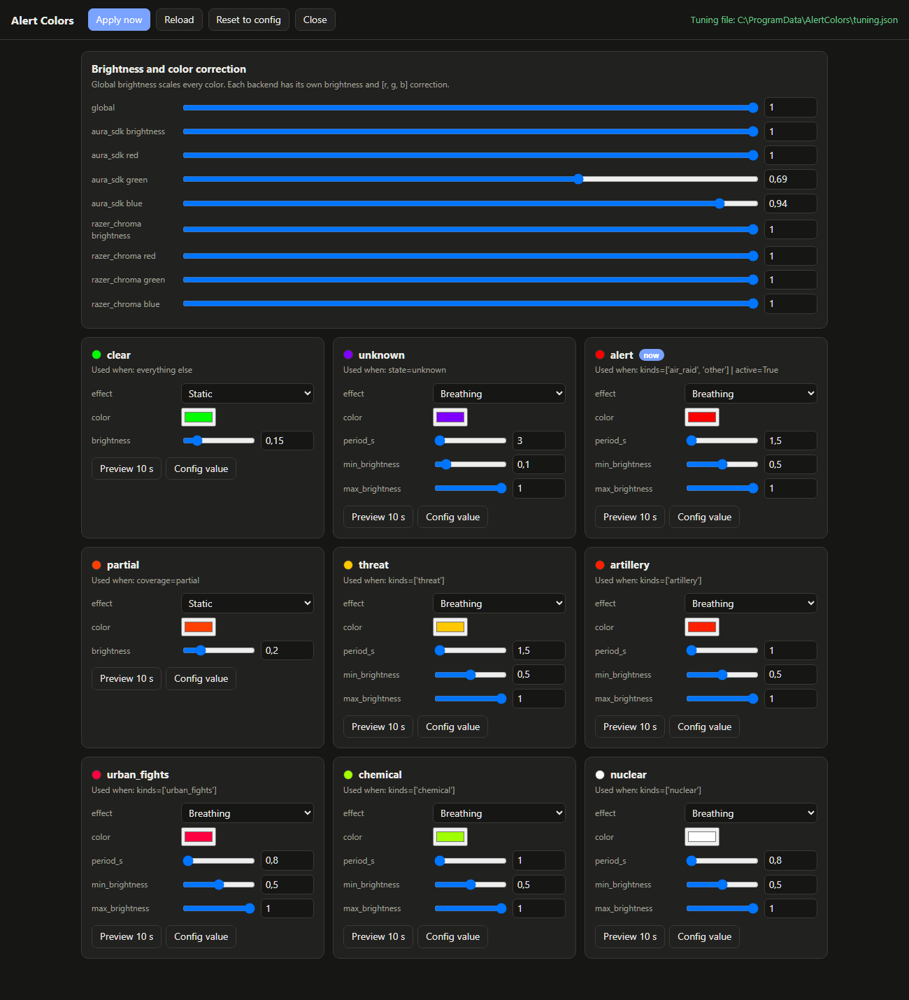
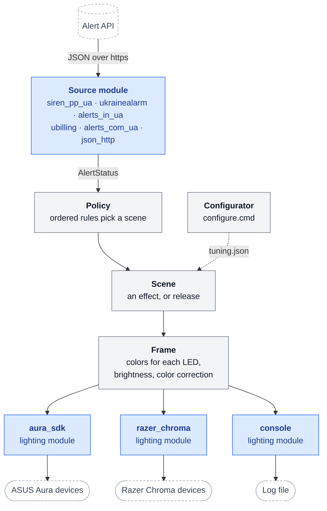

# alert-colors

## Goal

Show the status of an alert source on the RGB lighting that your PC already
has. You see the status at a glance, also when the screen is off or a game
runs in full screen.

The app is a small engine with exchangeable parts:

- **Sources** read the status from a web API. Any JSON API works through
  configuration, and named presets cover known APIs.
- **Rules** turn the status into a scene, and a **scene** runs one of 13 LED
  effects, or gives the LEDs back to their vendor app.
- **Lighting modules** drive the hardware. ASUS Aura (Armoury Crate) and
  Razer Chroma are included. A build can contain any set of modules, or none.

The shipped configuration shows air-raid alerts in Ukraine. It polls a public
alert API once a second, with no API key:

| State | When | Look |
|---|---|---|
| N | No active alert | Dim steady green |
| R | An alert on the watched place, its district or its oblast | Red breathing |
| Y | A preliminary threat on the watched place | Yellow breathing |
| P | No alert on the place, but an alert elsewhere in the oblast | Steady orange |
| unknown | No data, or old data | Slow purple breathing |

The watched place in the repository is the test region of the API. The setup
asks you for your city, community, district or oblast.

Warning: Do not use this app as your only alert source. It shows data from a
third-party API, and a network fault or an API change can delay that data.
Use an official alert app as well.

## Supported modules

Each module has one job. A build can contain any set of them. The full guide
tells [which modules your PC needs](docs/SETUP.md#2-choose-the-modules).

**Lighting: shows the status on the hardware**

| Module | What it is for | It needs |
|---|---|---|
| `aura_sdk` | ASUS Aura devices: motherboard, ASUS graphics card, ARGB headers (LED strips, fans) | Armoury Crate with Aura Sync; the app runs with admin rights |
| `razer_chroma` | Razer Chroma devices: keyboards (per column), mice | Razer Synapse, with Chroma apps allowed |
| `console` (core) | No hardware: writes each scene change to the log | Nothing |

**Sources: read the status from an API**

| Module | What it is for | Key |
|---|---|---|
| `siren_pp_ua` (default) | Ukrainian air-raid alerts, community level, from a public mirror of the official API. The fastest source without a key | No |
| `ukrainealarm` | The same data from the official ukrainealarm.com API | Yes |
| `alerts_in_ua` | Alerts from alerts.in.ua, community level | Yes |
| `ubilling` | Alerts from ubilling.net.ua, oblast level only. A fallback | No |
| `alerts_com_ua` | Alerts from alerts.com.ua, oblast level only. Its data was frozen on 2026-11-08 | No |
| `json_http` (core) | Any other JSON API, configured in `config.toml`. Each source above is a preset of it | Optional |

## Minimal setup

Run these commands in a Command Prompt (`cmd`):

```bat
git clone https://github.com/omahasdev/alert-colors "%USERPROFILE%\alert-colors"
"%USERPROFILE%\alert-colors\setup.cmd" region
"%USERPROFILE%\alert-colors\setup.cmd" install
```

1. `region` chooses your city. If Python 3.14 is not installed, type **y** to
   install it with `winget`. Then type a part of the city name ("dnipro" finds
   "Дніпро"), and type its number. You can also choose a community, a district or an oblast.
2. `install` builds, installs and starts the app. Accept the UAC prompt.

To change the city later, run the `region` command again. It applies the new
city to the running app.

Then, if you use ASUS devices, do this one time in Armoury Crate:

1. Open **Aura Sync** and turn on **In-Game lighting effects**.
2. Open the in-game lighting priority list, then move **AlertColors.exe** to the top.

Caution: Make sure that **AlertColors.exe** stays at the top of the priority
list. If an other app is above it, Armoury Crate gives the LEDs to that app,
and the PC LEDs do not show the alert status.

Note: After the install, and after each start of the app, the PC LEDs (ASUS
Aura) can need approximately 30 s before they change. The ASUS SDK first scans
all devices. The Razer devices change at once.

If your PC has only one lighting system, give it to the install:
`setup.cmd install -Lighting razer_chroma` or `setup.cmd install -Lighting aura_sdk`.
Without git, download the ZIP of the repository and extract it to the same folder.

**Full setup guide:** [docs/SETUP.md](docs/SETUP.md). It has the requirements,
a step-by-step clean install, the modules for your PC, all `setup.cmd`
actions, the config of your PC, every configuration key, the security model
and troubleshooting.

## Configurator

Double-click **`configure.cmd`** in the project folder to tune the running app
in your browser. It needs no admin rights. After the minimal setup, you can also
run this command:

```bat
"%USERPROFILE%\alert-colors\configure.cmd"
```



- **Scene cards.** Each card shows one scene and the rule that selects it. The
  forms come from the effect schemas, so each of the 13 effects gets its own
  controls.
- **Preview 10 s.** Shows the form values of one scene on the LEDs, without saving them.
- **Apply now.** The running app applies the changes within 1 s, with no restart.
- **Brightness and color correction.** A global brightness, and the brightness
  and `[r, g, b]` correction of each lighting backend.
- **Reset to config.** Removes all live changes, so the `config.toml` values apply again.

The configurator writes `C:\ProgramData\AlertColors\tuning.json`. Only your
account can write this file. The app accepts only scenes, brightness and color
correction from it. The page listens only on `127.0.0.1` and needs a random
token for every request. It closes after 30 min without use.

## Architecture

The project is a small core with optional modules. `build.toml` selects the
modules that go into the exe. A build can have any set of modules, or none:
then the app only polls the API and writes the scene to its log.



Blue boxes are the exchangeable modules: sources and lighting. Gray boxes are the engine. Dashed boxes are outside the app.

| Module | Main type | What it does |
|---|---|---|
| `sources/` | `AlertSource` | `fetch()` gives an `AlertStatus` |
| `sources/json_http.py` | (core) | Any JSON API from the config, with JMESPath fields |
| `sources/siren_pp_ua.py`, `ukrainealarm.py`, `ubilling.py`, `alerts_in_ua.py`, `alerts_com_ua.py` | presets | Optional named defaults for known APIs |
| `policy.py` | `Policy` | Ordered rules: `AlertStatus` to a scene name |
| `scenes.py` | `Scene` | An effect, or a release: each backend gives its LEDs back to its vendor app |
| `effects.py` | `Effect` | `colors(t, n)`: one color for each LED, with a parameter schema |
| `frame.py` | `Frame` | An effect at one moment, with brightness and color correction |
| `lighting/` | `LightingBackend` | `show(frame)`, `release()`: `console` (core), `aura_sdk`, `razer_chroma` |
| `outputs.py` | `BackendWorker` | One thread for each backend, newest frame wins, retry |
| `daemon.py` | `Daemon` | Poller thread with backoff, and the render loop |
| `tuning.py`, `tuner.py` | `TuningWatcher`, `Tuner` | The live tuning file and the configurator page |
| `http.py` | `request_json` | Network limits: https only, no redirects, no private addresses |
| `stop_signal.py` | | Named event for a graceful stop |
| `config.py` | `App` | Builds everything from `config.toml` |
| `regions.py` | `Place` | The place picker of the setup: search in the region tree of the API |

To add a part, write one module and register it by name:

- **A JSON API:** `sources/<name>.py` with `register_preset("<name>", DEFAULTS)`.
  Then add the name to `sources.OPTIONAL_MODULES`.
- **A non-JSON API:** a source class with `@SOURCES.register("<name>")`.
- **A lighting system** (OpenRGB, Corsair, Philips Hue): `lighting/<name>.py` with
  `@BACKENDS.register("<name>")`. Then add the name to `lighting.MODULE_NEEDS`.
- **An effect:** a class with `@effect("<name>", "<title>", [params])` in
  `effects.py`. The configurator shows its form automatically.

```
setup.cmd                    double-click: build, install, update, restart, status, uninstall
configure.cmd                double-click: the configurator
scripts\manage.ps1           the logic of setup.cmd
build.toml                   build profile: the optional modules
config.toml                  all settings (the defaults); examples\sources\: a block for each source
requirements-build.txt       exact build versions with SHA-256 hashes
packaging\                   PyInstaller spec and exe metadata
src\alert_colors\            the app
tests\                       unit tests (every build runs them)
docs\                        the full setup guide and the screenshot
```

## License

MIT. See [LICENSE](LICENSE).

This project is not affiliated with ASUS, Razer or the alert API operators.
Armoury Crate, Aura and Razer Chroma are trademarks of their owners.
