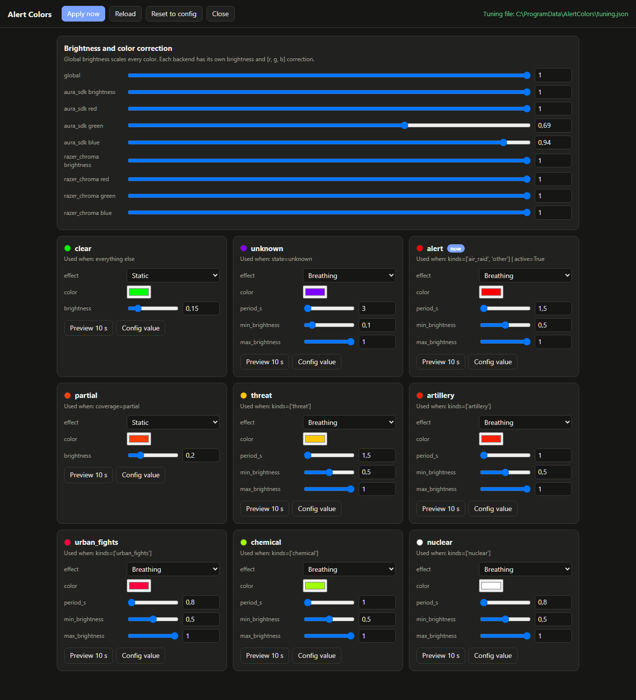

# alert-colors

## Goal

Show the status of an alert source on the RGB lighting that your PC already
has. You see the status at a glance, also when the screen is off or a game
runs in full screen.

The app is a small engine with exchangeable parts:

- **Sources** read the status from a web API. Any JSON API works through
  configuration, and named presets cover known APIs.
- **Rules** turn the status into a scene, and a **scene** runs one of 13 LED
  effects, or gives the LEDs back to their vendor app.
- **Lighting modules** drive the hardware. ASUS Aura (Armoury Crate) and
  Razer Chroma are included. A build can contain any set of modules, or none.

The shipped configuration shows air-raid alerts in Ukraine. It polls a public
alert API once a second, with no API key:

| Scene | When | LED colors |
|---|---|---|
| `clear` | No active alert | Dim steady green |
| `alert` | An alert on the watched place, its district or its oblast | Red breathing |
| `threat` | A preliminary threat on the watched place | Yellow breathing |
| `partial` | No alert on the place, but an alert elsewhere in the oblast | Steady orange |
| `unknown` | No data, or data older than `stale_after_s` | Slow purple breathing |

The scene names are the `[scenes.*]` sections of `config.toml`.

The watched place in the repository is the test region of the API. The setup
asks you for your city, community, district or oblast.

Warning: Do not use this app as your only alert source. It shows data from a
third-party API, and a network fault or an API change can delay that data.
Use an official alert app as well.

## Supported modules

Each module has one job. A build can contain any set of them. The full guide
tells [which modules your PC needs](docs/SETUP.md#2-choose-the-modules).

**Lighting: shows the status on the hardware**

| Module | What it is for | Requirements |
|---|---|---|
| `aura_sdk` | ASUS Aura devices: motherboard, ASUS graphics card, ARGB headers (LED strips, fans) | Armoury Crate with Aura Sync. The app then runs with admin rights |
| `razer_chroma` | Razer Chroma devices: keyboards (per column), mice | Razer Synapse, with Chroma apps allowed |
| `console` (always in the build) | No hardware: writes each scene change to the log | Nothing |

**Sources: read the status from an API**

| Module | What it is for | API key required |
|---|---|---|
| `siren_pp_ua` (default) | Ukrainian air-raid alerts, community (hromada) level, from a public mirror of the official API. The fastest source without an API key | No |
| `ukrainealarm` | The same data from the official ukrainealarm.com API | Yes |
| `alerts_in_ua` | Alerts from alerts.in.ua, community (hromada) level | Yes (a token) |
| `ubilling` | Alerts from ubilling.net.ua, oblast level only. A good fallback source | No |
| `alerts_com_ua` | Alerts from alerts.com.ua, oblast level only. The service stopped updating its data (checked 2026-11-08) | No |
| `json_http` (always in the build) | Any other JSON API, configured in `config.toml`. Each source above is a preset of it | Only if that API needs one |

The app reads several sources, best data first, and uses the next one when a
server is down: a service with a saved token, then `siren_pp_ua`, then
`ubilling`. The [sources guide](docs/SOURCES.md) explains the order, and tells
how to get a token and save it.

## Minimal setup

Run these commands in a Command Prompt (`cmd`):

```bat
git clone https://github.com/omahasdev/alert-colors "%USERPROFILE%\alert-colors"
"%USERPROFILE%\alert-colors\setup.cmd" region
"%USERPROFILE%\alert-colors\setup.cmd" install
```

1. `region` chooses your city. If Python 3.14 is not installed, type **y** to
   install it with `winget`. Then type a part of the city name ("kyiv" finds
   "м. Київ"), and type its number. You can also choose a community, a district or an oblast.
2. `install` builds, installs and starts the app. Accept the UAC prompt.

To change the city later, run the `region` command again. It applies the new
city to the running app.

If you have a token for an official alert service, save it with
`setup.cmd token`. The app then uses that service first, and keeps the keyless
source as a backup. The [sources guide](docs/SOURCES.md#save-a-token) tells how to get a token and save it.

Then, if you use ASUS devices, do this one time in Armoury Crate:

1. Open **Aura Sync** and turn on **In-Game lighting effects**.
2. Open the in-game lighting priority list, then move **AlertColors.exe** to the top.

Caution: Make sure that **AlertColors.exe** stays at the top of the priority
list. If another app is above it, Armoury Crate gives the LEDs to that app,
and the PC LEDs do not show the alert status.

Note: After the install, and after each start of the app, the PC LEDs (ASUS
Aura) change only after the first device scan of the ASUS SDK, which is slow.
The Razer devices change at once.

If your PC has only one lighting system, name its module in the install command:
`setup.cmd install -Lighting razer_chroma` or `setup.cmd install -Lighting aura_sdk`.
Without git, download the ZIP of the repository and extract it to the same folder.

To uninstall, run this command, then accept the UAC prompt:

```bat
"%USERPROFILE%\alert-colors\setup.cmd" uninstall
```

It stops the app (the LEDs go back to their vendor apps), then removes the
autostart, the Armoury Crate entry and the installed files. Then delete the
folders `%USERPROFILE%\alert-colors` and `%APPDATA%\AlertColors` (your own
config, with the watched place). The full guide lists [all items that stay](docs/SETUP.md#maintain-update-restart-uninstall).

**Full setup guide:** [docs/SETUP.md](docs/SETUP.md). It has the requirements,
a step-by-step clean install, the modules for your PC, all `setup.cmd`
actions, your own config file, every setting in `config.toml`, the security model
and troubleshooting.

**Sources and tokens:** [docs/SOURCES.md](docs/SOURCES.md). It compares the
alert sources, explains their order, and tells how to get and save a token for
[ukrainealarm](docs/SOURCES.md#ukrainealarm) and
[alerts_in_ua](docs/SOURCES.md#alerts_in_ua).

**Configuration reference:** [docs/CONFIG.md](docs/CONFIG.md). It explains
each config file and every setting, with its default.

**Command reference:** [docs/COMMANDS.md](docs/COMMANDS.md). It lists every
`setup.cmd` action and option, and every `AlertColors.exe` command with its
exit codes.

## Configurator

Double-click **`configure.cmd`** in the project folder to tune the running app
in your browser. It needs no admin rights. After the minimal setup, you can also
run this command:

```bat
"%USERPROFILE%\alert-colors\configure.cmd"
```



- **Scene cards.** Each card shows one scene and the rule that selects it. The
  forms come from the effect schemas, so each of the 13 effects gets its own
  controls.
- **Preview 10 s.** Shows the form values of one scene on the LEDs, without saving them.
- **Apply now.** The running app applies the changes within 1 s, with no restart.
- **Brightness and color correction.** A global brightness, and the brightness
  and `[r, g, b]` correction of each lighting backend.
- **Reset to config.** Removes all live changes, so the `config.toml` values apply again.

The configurator writes `C:\ProgramData\AlertColors\tuning.json`. Only your
account can write this file. The app accepts only scenes, brightness and color
correction from it. The page listens only on `127.0.0.1` and needs a random
token for every request. It closes after 30 min without use.

## Documentation

Full guides live in [`docs/`](docs/README.md):

- **[Setup](docs/SETUP.md)** — a clean install, the modules for your PC, and every `setup.cmd` action.
- **[Commands](docs/COMMANDS.md)** and **[Configuration](docs/CONFIG.md)** — every action, option, and setting.
- **[Sources](docs/SOURCES.md)** — the alert sources, their order, and how to save a token.
- **[Architecture](docs/ARCHITECTURE.md)** — the data-flow diagram, the module map, and how to add your own
  source, lighting system, or effect.

## License

MIT. See [LICENSE](LICENSE).

This project is not affiliated with ASUS, Razer or the alert API operators.
Armoury Crate, Aura and Razer Chroma are trademarks of their owners.
