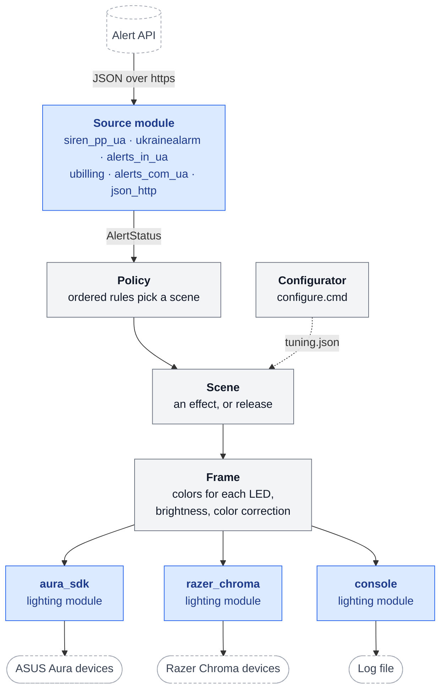

# Architecture

[← Documentation](README.md)

The project is a small core with optional modules. [`build.toml`](../build.toml)
selects the modules that go into the exe. A build can have any set of modules,
or none: then the app only polls the API and writes the scene to its log.

**Blue** boxes are the exchangeable modules (sources and lighting). **Gray**
boxes are the engine. **Dashed** boxes are outside the app.

## Modules

| Module | Primary class | What it does |
|---|---|---|
| `sources/` | `AlertSource` | `fetch()` gives an `AlertStatus` |
| `sources/json_http.py` | `JsonHttpSource` | Any JSON API from the config, with JMESPath fields |
| `sources/failover.py` | `FailoverSource` | The sources in the order of use: the next one when the first has no data |
| `sources/siren_pp_ua.py`, `ukrainealarm.py`, `ubilling.py`, `alerts_in_ua.py`, `alerts_com_ua.py` | (presets, no class) | Optional named defaults for known APIs |
| `user_env.py` | | Tokens in the user environment (`setup.cmd token`), never in a config file |
| `policy.py` | `Policy` | Ordered rules: `AlertStatus` to a scene name |
| `scenes.py` | `Scene` | An effect, or a release: each backend gives its LEDs back to its vendor app |
| `effects.py` | `Effect` | `colors(t, n)`: one color for each LED, with a parameter schema |
| `frame.py` | `Frame` | An effect at one moment, with brightness and color correction |
| `lighting/` | `LightingBackend` | `show(frame)`, `release()`: `console` (always in the build), `aura_sdk`, `razer_chroma` |
| `outputs.py` | `BackendWorker` | One thread for each backend, newest frame wins, retry |
| `daemon.py` | `Daemon` | Poller thread with backoff, and the render loop |
| `tuning.py`, `tuner.py` | `TuningWatcher`, `Tuner` | The live tuning file and the configurator page |
| `http.py` | `request_json` | Network limits: https only, no redirects, no private addresses |
| `stop_signal.py` | | Named event for a graceful stop |
| `config.py` | `App` | Builds everything from `config.toml` |
| `regions.py` | `Place` | The place picker of the setup: search in the region tree of the API |

## Add your own

Write one module and register it by name:

- **A JSON API:** `sources/<name>.py` with `register_preset("<name>", DEFAULTS)`.
  Then add the name to `sources.OPTIONAL_MODULES`.
- **A non-JSON API:** a source class with `@SOURCES.register("<name>")`.
- **A lighting system** (OpenRGB, Corsair, Philips Hue): `lighting/<name>.py` with
  `@BACKENDS.register("<name>")`. Then add the name to `lighting.MODULE_NEEDS`.
- **An effect:** a class with `@effect("<name>", "<title>", [params])` in
  `effects.py`. The configurator shows its form automatically.
